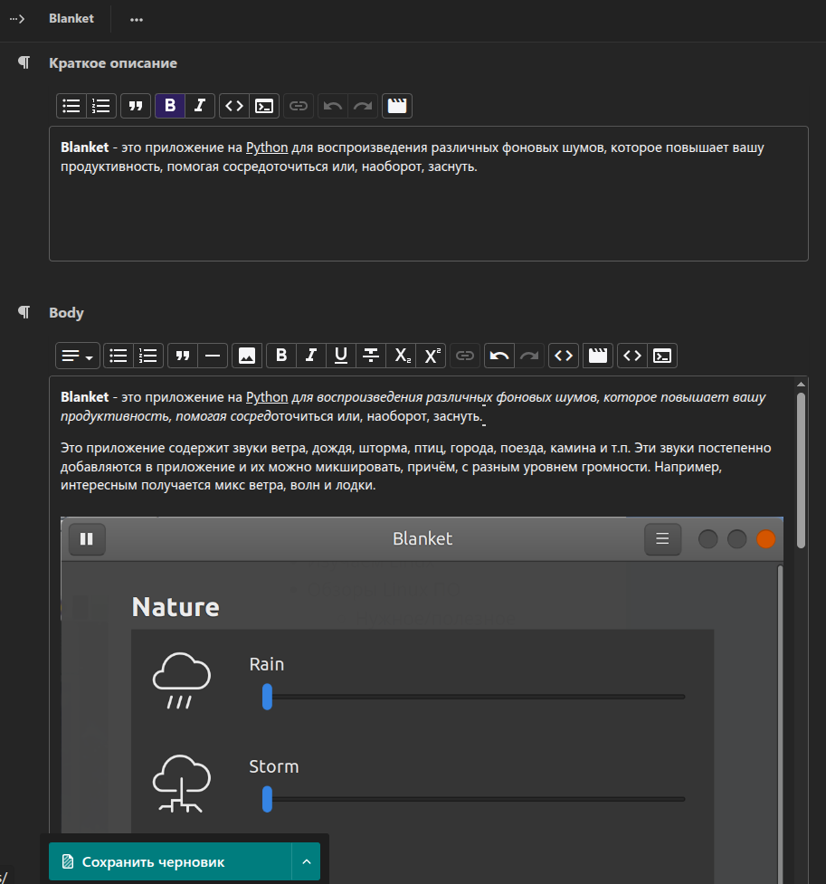

# wagtail-prose-editor-images

**A native Wagtail Image Chooser button for `django-prose-editor`.** It connects the Prose editor's Image extension to Wagtail's existing chooser modal, adds editor styles, and resolves the selected image URL through a permission-checked endpoint.

This package enhances the *editor experience*; it does not replace Wagtail's image model, media storage, rendition policy, or the front-end HTML/CSS of your site.

[English](README.md) · [Русский](README.ru.md) · [Deutsch](README.de.md) · [Español](README.es.md) · [Français](README.fr.md) · [Italiano](README.it.md) · [Português (Brasil)](README.pt-BR.md) · [Nederlands](README.nl.md) · [Polski](README.pl.md) · [Türkçe](README.tr.md) · [简体中文](README.zh-CN.md) · [日本語](README.ja.md) · [한국어](README.ko.md)



## Features

- Opens Wagtail's standard image chooser from the Prose toolbar.
- Inserts the selected image using a configured Wagtail rendition URL (default: `width-1200`) returned by the permission-checked endpoint.
- Loads CSS/JavaScript through Wagtail admin hooks and follows the admin's neutral light/dark appearance.
- Checks permission to **choose that specific image**, not just permission to enter the admin. A user restricted by Wagtail Collections must not receive URLs for images they cannot choose.
- Provides improved inline and block code styling alongside the image integration.

## Audit/release status

This source bundle prepares version `0.2.3` for a possible next release. Static syntax/package checks have been run, but a full Django/Wagtail integration suite has not run in the bundle build environment. Do not upload to PyPI until the release checklist in `../../04-docs/UPGRADE_AND_RELEASE.md` is complete.

## Requirements

Package metadata declares `wagtail>=6.0` and `django-prose-editor>=0.26`. Compatibility with all combinations is not covered by an automated test matrix in this source bundle. Confirm the exact versions used by your site, especially after major Wagtail upgrades.

## Installation

```bash
pip install wagtail-prose-editor-images
```

Enable the apps in `INSTALLED_APPS`:

```python
INSTALLED_APPS = [
    # ... Django and Wagtail apps ...
    "wagtail.images",
    "django_prose_editor",
    "wagtail_prose_editor_images",
    # ... your page apps ...
]
```

The plugin registers its admin JavaScript, CSS, and URL through Wagtail hooks. Add no manual URL route unless your project uses a custom admin setup that bypasses the hooks.

## Enable the Image extension

The field must enable Prose's `Image` extension:

```python
from django_prose_editor.fields import ProseEditorField
from wagtail.models import Page

class ArticlePage(Page):
    body = ProseEditorField(
        extensions={
            "Bold": True,
            "Italic": True,
            "Heading": {"levels": [2, 3]},
            "Image": True,
            "Code": True,
            "CodeBlock": True,
        }
    )
```

Use your actual page model and the extension set already supported by your installed `django-prose-editor` version. This example shows the minimum relevant change: `"Image": True`.

## Image permissions and URL behavior

The endpoint is an admin endpoint and requires Wagtail admin access plus the image's `choose` permission. An inaccessible or missing image returns the same not-found response to avoid exposing private image IDs. By default, the endpoint asks the configured Wagtail image model for a `width-1200` rendition. Change the spec with `WAGTAIL_PROSE_EDITOR_IMAGES_RENDITION_SPEC` if your templates and storage policy need another size.

**Disk-quota note:** a rendition can create an additional file on disk. Keep the spec allowlist in your concrete image model intentional, and estimate the number and size of images inserted into article bodies before choosing a new default. In this project, `width-1200` is outside the CustomImage pass-through list so that public article images do not silently receive the multi-megabyte original. If rendition generation fails, the endpoint logs the error and falls back to the original as a last resort; monitor logs and storage errors because that fallback can be large.

If your deployment uses private media storage, signed URLs, a CDN, or custom image delivery, review whether the returned rendition URL matches that architecture. The plugin cannot make a public media URL private after it has been inserted into public article HTML. Moving or renaming image files may also leave stale hard-coded URLs in already-saved HTML; a storage relocation must include a URL migration plan.

## Recommended combinations

- **Use with `wagtail-image-directories`** if you want new originals to be stored under `images/<year>/<slug>/` and managed through the Image Navigator. Verify the concrete image model and migrations before uploading production content.
- **Use with `wagtail-mptt-comments`** only if your comments' administrator responses or rich-text fields also use Prose and you need the same image chooser in those fields. The comments package is otherwise independent.
- No dependency on the forum, desktop publisher, or comments database tables is introduced by this package.

## Verification after installation

1. Open a page using `ProseEditorField` in the Wagtail admin.
2. Confirm the Image toolbar action opens the Wagtail chooser.
3. Select an image from a Collection the user can access and confirm it inserts correctly.
4. Repeat with a user who cannot choose an image in a restricted Collection; the endpoint should not return its URL.
5. Confirm the article preview and public page style the inserted image as expected.

## License and support

MIT. Source and issue tracker: [GitHub](https://github.com/vovansrnd/wagtail-prose-editor-images). Include Python, Django, Wagtail, `django-prose-editor`, browser console errors, and relevant permission configuration in bug reports.


To install **the candidate source in this bundle** (rather than the already-published PyPI release), run from this package directory:

```bash
python -m pip install .
# For editable development instead:
python -m pip install -e .
```

`pip install wagtail_prose_editor_images` selects the version currently published on PyPI. The candidate version shown in `pyproject.toml` is not published by this archive operation; publish it only after the release checklist in `../../04-docs/UPGRADE_AND_RELEASE.md` passes.
